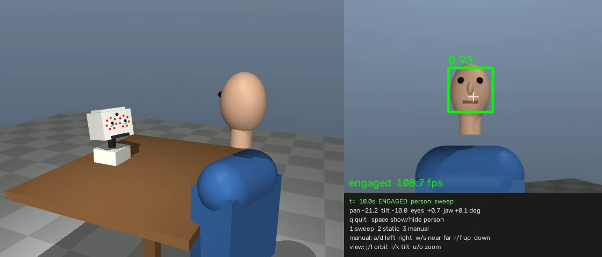

# Berrick — low-cost robotic head for HRI

[](https://github.com/RiccardoBerra/Berrick-RobotHead/actions/workflows/ci.yml)

Berrick is a 3D-printable robotic head (≈250 €, ≈3 days to build) driven by a
Raspberry Pi. It detects faces, turns its head and eyes to gaze at the person, and
uses an LED ring for **light-based gazing**: a social cue that tells the user when the
robot is actually looking at them.

> R. Berra, F. Setti, M. Cristani, *"Berrick: a low-cost robotic head platform for
> human-robot interaction"*, IEEE SMC 2019, pp. 559–566.
> [doi:10.1109/SMC.2019.8913932](https://doi.org/10.1109/SMC.2019.8913932)

This repository contains **v2** of the software, rewritten for current hardware
and Raspberry Pi OS. The original 2019 code used in the paper is preserved in
[`legacy/`](legacy/) together with a list of the bugs fixed.

## What's new in v2

- Runs on **Raspberry Pi OS Bookworm/Trixie** and on **every Pi, Pi 5 included**
  (`picamera2`, `gpiozero`, `neopixel_spi`); the 2019 stack (`pigpio`, `rpi_ws281x`)
  is still supported on Pi 1–4.
- **YuNet** DNN face detector (much more robust than Haar cascades); Haar is kept as
  a fallback with OpenCV 4.x.
- Correct face centre, real PID with `dt`, dead-band, anti-windup and output limits.
- Smooth, slew-rate-limited servo motion in a background thread (no blocking loops).
- Engage/disengage state machine, optional mouth greeting and eye servos.
- All calibration in one **TOML config file**; interactive servo calibration tool.
- CSV logs of detections and engagement episodes; the keyboard HRI experiment from
  the paper is built in.
- **3D simulation in MuJoCo** (macOS, Linux, Windows): the real tracker drives a
  virtual Berrick looking at a virtual person — no robot needed.
- Runs on a laptop with a webcam and mock hardware for development.
- Tests, linting and CI; systemd unit to start at boot.

## Hardware

| Part | Notes |
|---|---|
| Raspberry Pi 3/4/5 | Pi 5 → use `servos.backend = "gpiozero"` |
| Raspberry Pi Camera (any) | or a USB webcam |
| 3–5 hobby servos (SG90/MG90S) | pan, mouth; optional tilt and eyes |
| SK6812 RGBW LED ring, 14 px | data on GPIO10 (SPI MOSI) |
| 5 V supply ≥ 3 A for servos | common ground with the Pi |

Default wiring (BCM numbering), all changeable in the config:

| Function | GPIO | Pulse range (µs) | Home |
|---|---|---|---|
| Pan (neck left/right) | 27 | 1200–2400 | 1850 |
| Tilt (neck up/down) | 22 | 800–2000 | 1350 |
| Mouth | 17 | 1100 (open) – 2100 (closed) | 2100 |
| Eye X | 19 | 1000–1700 | 1200 |
| Eye Y | 26 | 600–1800 | 1200 |
| LED ring data | 10 | — | — |

> **Power:** never power servos from the Pi's 5 V pin. Use a separate supply and
> connect its ground to the Pi's ground.

## Usage guide

### 1. Prepare the Raspberry Pi

Flash **Raspberry Pi OS (64-bit)** with Raspberry Pi Imager, then:

```bash
sudo apt update && sudo apt full-upgrade -y
sudo apt install -y git python3-venv python3-picamera2 python3-lgpio
sudo raspi-config nonint do_spi 0        # enable SPI for the LED ring
# Pi 1–4 only, optional, for jitter-free servos:
sudo apt install -y pigpio python3-pigpio && sudo systemctl enable --now pigpiod
```

### 2. Install Berrick

```bash
git clone https://github.com/RiccardoBerra/Berrick-RobotHead.git
cd Berrick-RobotHead
python3 -m venv --system-site-packages .venv   # system packages = picamera2/libcamera
source .venv/bin/activate
pip install -e ".[pi]"          # add ",pigpio" or ",ws281x" for the 2019 drivers
berrick download-model          # YuNet face detector → models/
```

### 3. Configure

```bash
cp config/berrick.example.toml config/berrick.toml
nano config/berrick.toml
```

The things you most likely need to change:

- `servos.backend`: `"pigpio"` (Pi 1–4, needs `pigpiod`) or `"gpiozero"` (any Pi, required on Pi 5).
- `camera.vflip` / `hflip` if the camera is mounted upside down or mirrored.
- `[servos.*]` pins and pulse limits for your build (see step 4).
- `[tilt] enabled`, `[servos.eye_x] enabled`, … to enable extra axes.

Every key is optional; anything omitted keeps the default of the original robot.

### 4. Calibrate the servos

Move each servo by hand to find safe limits **before** running the tracker:

```bash
berrick -c config/berrick.toml calibrate pan
```

`a`/`d` move ±10 µs, `A`/`D` ±50 µs, `h` goes home, `q` quits. Write the end stops
and centre you find into `min_us`, `max_us` and `home_us`. Repeat for `tilt`,
`mouth`, `eye_x`, `eye_y`.

### 5. Run

```bash
berrick -c config/berrick.toml run                 # with preview window (desktop session)
berrick -c config/berrick.toml run --no-preview    # headless / over SSH
```

Press `q` in the window or `Ctrl+C` to stop; the servos return home and are released.

When a face is seen for `behavior.acquire_frames` frames, Berrick **engages**: the LED
ring lights up and the head follows the face. If the face is lost for
`lost_timeout_s` it **disengages** (LEDs off) and after `return_home_after_s` it
returns to the home position.

**Tuning:** if the head turns *away* from the face, flip `[pan] invert`. If it
oscillates, lower `pid.kp` or raise `deadband`; if it is sluggish raise `pid.kp`
(and `servos.pan.max_speed_us_s`).

### 6. Logs and the HRI experiment

```bash
berrick -c config/berrick.toml run --log-dir logs
```

writes `logs/events-<timestamp>.csv` with every detection (score, box) and every
engagement episode (duration) — the v2 equivalent of the paper's `report.txt`.

To repeat the **keyboard experiment** of the paper (the participant presses a key
whenever they feel watched, and the robot's real state is recorded alongside):

```bash
berrick -c config/berrick.toml run --experiment --duration 180 --stop-after-experiment
```

Output: `logs/experiment-<timestamp>.csv` with `time_s, robot_engaged, key`.
Keys are read from the terminal, so keep the terminal focused (or use `--no-preview`).

### 7. Start at boot (optional)

```bash
sudo cp deploy/berrick.service /etc/systemd/system/
sudo nano /etc/systemd/system/berrick.service   # fix User and paths
sudo systemctl daemon-reload && sudo systemctl enable --now berrick
journalctl -u berrick -f                        # follow the logs
```

### Simulate on a Mac (no robot needed)



`berrick sim` runs the **same tracker, PID and state machine** as the robot against
a MuJoCo model of Berrick (pan, tilt, eyes, jaw, 2×7 LED rings) and a virtual person
sitting in front of it. Joint ranges come from your servo limits, so the config you
tune in simulation is the one you deploy.

```bash
python3 -m venv .venv && source .venv/bin/activate
pip install -e ".[sim]"
berrick download-model                       # only needed for --real-detector/--face
berrick sim                                  # person sweeps left/right and walks away
berrick sim --enable tilt eye_x eye_y        # all axes
berrick sim --person manual                  # move the person yourself (a/d w/s r/f)
berrick -c config/berrick.toml sim           # test your own config / PID gains
```

Window: left = free 3D view, right = what the robot's camera sees with the detection
overlay. Keys: `space` show/hide the person, `1`/`2`/`3` sweep/static/manual,
`a d w s r f` move the person, `j l i k u o` orbit/zoom the view, `q` quit.

Perception modes:

| Mode | What detects the face |
|---|---|
| default | ground truth projected into the robot camera, with `sim.noise_px` jitter and `sim.miss_rate` misses — fast, isolates the control loop |
| `--real-detector` | the real YuNet/Haar detector on the rendered frames |
| `--face photo.jpg` | as above, with your portrait photo (3:4 crop) on the person |
| `--twin` | **digital twin**: your Mac's webcam + real detector drive the 3D robot |

Batch / tuning runs:

```bash
berrick sim --headless --fast --duration 60            # prints engagement % and mean error
berrick sim --headless --fast --duration 30 --record out.mp4 --log-dir logs
```

Simulation limits: servos are ideal position actuators (no backlash, no
load-dependent speed), the camera has no latency or motion blur, and frames come at
exactly `camera.fps`. Use it to check directions, ranges and behaviour, then fine
tune the PID on the real robot.

### Develop on a laptop with a webcam

```bash
python3 -m venv .venv && source .venv/bin/activate
pip install -e ".[dev,sim]"
berrick download-model
berrick -c config/desktop.toml run      # webcam + mock servos/LEDs (no 3D view)
pytest && ruff check . && ruff format --check .
```

Run with `-v` to see debug logs, including mock servo and LED output.

## Project layout

```
src/berrick/
  cli.py         command line (run, calibrate, download-model)
  config.py      typed TOML configuration with defaults
  camera.py      picamera2 / OpenCV camera backends
  detection.py   YuNet and Haar face detectors
  pid.py         PID controller
  servos.py      pigpio / gpiozero / mock backends + slew-limited ServoBank
  leds.py        neopixel_spi / rpi_ws281x / mock LED ring
  tracker.py     engagement state machine and gaze control, CSV event log
  experiment.py  keyboard HRI experiment
  sim/           MuJoCo model, world, sim backends and `berrick sim` runner
config/          example and desktop configs
deploy/          systemd unit
legacy/          original 2019 code and experiment data
tests/           pytest suite (no hardware needed)
```

## Troubleshooting

| Symptom | Fix |
|---|---|
| `cannot reach pigpiod` | `sudo systemctl enable --now pigpiod`, or use `servos.backend = "gpiozero"` (mandatory on Pi 5) |
| `No module named 'picamera2'` | create the venv with `--system-site-packages` and `apt install python3-picamera2` |
| `YuNet model not found` | `berrick download-model` |
| `OpenCV 5.x has no Haar cascades` | use `detector.backend = "yunet"`, or `pip install "opencv-python<5"` |
| Servos jitter with gpiozero | software PWM; use pigpio on Pi 1–4 or a PCA9685 board |
| LEDs don't light | enable SPI (`raspi-config`), check the data wire is on GPIO10 and the colour order (`rgbw`) |
| `simulation needs MuJoCo` | `pip install -e ".[sim]"` |
| Sim on headless Linux: GL errors | `export MUJOCO_GL=egl` (GPU) or `osmesa` (CPU, `apt install libosmesa6`) |
| `cv2.imshow` not implemented | `opencv-python-headless` is installed: `pip uninstall opencv-python-headless && pip install opencv-python` |
| `cannot open camera device 0` (desktop) | allow camera access for your terminal, or set `camera.device` |

## Citation

If you use Berrick in your research please cite the paper (see
[`CITATION.cff`](CITATION.cff)):

```bibtex
@inproceedings{berra2019berrick,
  title     = {Berrick: a low-cost robotic head platform for human-robot interaction},
  author    = {Berra, Riccardo and Setti, Francesco and Cristani, Marco},
  booktitle = {2019 IEEE International Conference on Systems, Man and Cybernetics (SMC)},
  pages     = {559--566},
  year      = {2019},
  doi       = {10.1109/SMC.2019.8913932}
}
```
